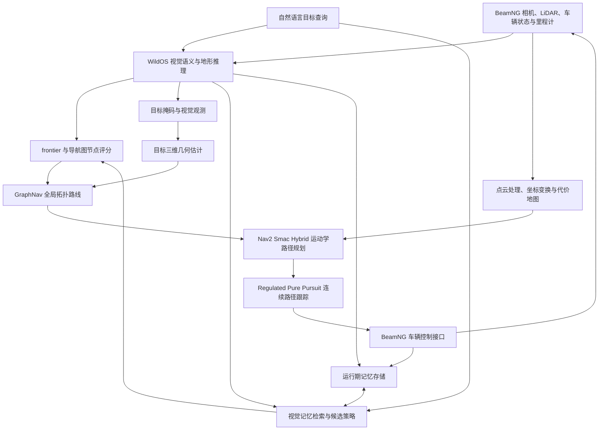

# WildOS 视觉记忆与 BeamNG 开放词汇导航

本项目研究如何在 WildOS 开放词汇视觉导航框架中加入轻量级视觉记忆，使移动机器人在同一地图、同一运行进程内连续接受不同物体查询时，能够利用先前的视觉观察、图结构位置和执行反馈，更快地安排后续搜索。

系统以 RGB 相机、LiDAR 和车辆里程计为输入，以目标搜寻与车辆路径执行为输出。视觉记忆服务于候选地点检索和探索评分；它不替代 WildOS 的感知与 frontier 探索，也不取代车辆规划器、障碍代价地图或到达判定。

## 研究问题

开放词汇导航允许用户在运行时给出自然语言目标，例如“红绿灯”或“加油站”。机器人开始任务时通常不知道目标在地图上的位置，必须在探索过程中不断结合当前视觉观察、环境几何和目标语义来决定下一步去哪里。

连续任务带来一个额外机会：机器人在寻找先前目标时，可能已经观察过其他地标，或经过后来查询所对应的区域。如果每次收到新查询都只从当前观察重新排序探索地点，这些历史信息就没有充分参与决策。本项目关注的问题是：如何用有限、可检索的运行期记忆保留这些线索，并在之后的目标搜索中重新利用它们，同时仍让当前观测、地图可达性和车辆规划约束决定实际行动。

设计目标是：

- 支持同一地图、同一进程中的连续目标查询；
- 保存紧凑的视觉、图节点、视点和执行反馈线索，而不是长期录制 RGB 视频；
- 让记忆影响候选地点和探索优先级，不把记忆中的位置直接等同于已确认目标；
- 保持语义感知、几何可通行性、全局路线选择和车辆路径跟踪各自职责清晰。

## 核心概念

### Frontier 与 traversability

Frontier 和 traversability 描述的是不同问题：

- **Frontier（探索边界）**表示已知区域与未知区域之间值得继续观察或探索的位置。它回答“接下来去哪里获取新信息”。
- **Traversability（可通行性）**表示地形或局部空间对车辆是否可行。它回答“车辆能否安全地通过这里”。

一个地点可以是有价值的 frontier，但由于障碍物、地形或车辆运动学限制而不可通行；可通行区域也不一定能带来新的探索信息。WildOS 的视觉评分与地形信息为导航图节点提供搜索依据，代价地图和车辆规划器再处理路径的几何可行性与碰撞约束。视觉记忆不会把这两类信息合并成另一张地图。

### 目标识别、目标定位与目标到达

目标搜寻包含彼此衔接、但含义不同的环节：

1. **识别**：当前图像中是否存在与查询语义相符的候选物体。
2. **定位**：结合相机、深度或 LiDAR 几何以及里程计，把候选物体转换到地图坐标系中的空间位置。
3. **规划与执行**：根据目标位置和车辆约束生成可行路径，并持续控制车辆沿路径运动。
4. **确认到达**：使用当前任务的目标证据和车辆相对目标的位置关系判断是否完成。

这些结果不能互相替代。图像掩码表示视觉候选，三维点表示几何估计，规划路径表示行动方案，车辆到达则需要独立的位置与任务确认。记忆召回可以指出“曾经在什么位置见过相似线索”，但不能单独证明当前查询的目标已经被找到。

## 端到端数据流

### 感知与探索

WildOS 接收相机画面和导航状态，利用视觉模型估计开放词汇语义、frontier 线索和可通行性相关信息。系统把这些线索关联到导航图上的候选节点，并根据当前目标与环境观察评估搜索方向。当前查询仍是语义判断的依据；视觉记忆为排序提供历史线索，不会把先前任务的目标状态沿用到新查询。

### 视觉观测与空间定位

当图像中出现目标候选时，目标掩码提供像素区域，三维定位模块再结合传感器几何和车辆位姿估计候选物体的位置。这个位置与观测时间、坐标系和当前任务相关联，以便后续规划能够正确解释它。视觉候选与三维位置都有不确定性，因此记忆检索和空间估计都应作为导航证据，而不是无条件的目标确认。

### 从全局路线到车辆运动

规划链路分层处理不同尺度的问题：

1. **WildOS 与 GraphNav**根据语义、探索价值和图结构选择全局拓扑方向或目标区域。
2. **Nav2 Smac Hybrid**在代价地图上生成符合阿克曼车辆运动学的路径，处理转弯半径、正反向运动和障碍约束。
3. **Regulated Pure Pursuit（RPP）**连续跟踪路径，并结合曲率、速度调节和车辆外形进行局部执行检查。
4. **BeamNG 车辆接口**把导航坐标和控制指令映射到仿真车辆、传感器及物理状态。

全局拓扑路线回答“要穿过哪些区域”，局部路径规划与跟踪回答“车辆如何按自身运动学和碰撞约束到达下一段路径”。前一层生成路线不代表后一层必然可执行，后一层的路径跟踪也不能反向替代目标语义判断。

## 视觉记忆设计

记忆在 WildOS 进程内维护，服务于连续查询期间的信息复用。它保留有界的视觉描述、图位置、确认视点或执行反馈，不建立第二套完整几何地图，也不把原始视频作为记忆内容。四类 Store 负责保存不同的信息；`RecallCandidatePolicy` 是候选判断策略，不是第五种记忆。

| 组件 | 保存的信息 | 在导航中的用途 |
| --- | --- | --- |
| `ExecutionExperienceStore` | 有界视觉描述及已执行方向 bin 的反馈 | 为有历史依据的探索方向提供执行经验反馈 |
| `GraphObservationStore` | 视觉观察、确认线索与现有图节点及朝向 bin 的关联 | 让后续查询能够从导航图位置检索历史观察 |
| `ConfirmedViewpointCache` | 与查询相关的已确认视点 | 为相同或相关目标查询提供曾有效的观察视角线索 |
| `PassiveLandmarkIndex` | 固定容量视觉描述符及 LiDAR 支持的空间位置 | 从场景地标中检索空间候选；检索结果只是提示 |
| `RecallCandidatePolicy` | 不单独保存地图或记忆 | 按当前位置、朝向和候选信息比较可召回视点 |

### 连续查询中的记忆交接

一次任务中的观察和执行反馈可以被写入相应 Store。收到下一条查询后，策略从当前查询出发检索可能相关的地标、图观察和确认视点，并把这些候选作为搜索排序的辅助信息。随后，导航仍需结合当前车辆位姿、当前查询、图结构和路径可行性选择行动。

因此，记忆解决的是**减少重复搜索和重用历史线索**的问题，而不是跳过感知、定位或规划。记忆候选可能过时、模糊或不可达；它必须与当前任务和地图状态结合评估。目标查询切换时，当前任务的确认状态与新的目标身份绑定，不能把旧目标确认误当作新目标确认。

## 坐标与接口契约

多传感器导航依赖数据在模块间保持一致。图节点、目标估计、里程计和导航路径必须明确共享的世界坐标系；传感器外参必须与实际安装位置一致；速度、角度和距离必须使用一致单位；图像、点云与位姿必须依据测量时间而不是处理完成时间进行关联。

在本项目的车辆模型中，`spot1/odom` 表示世界坐标系；`spot1/base_link` 位于后轴中心并保留测得的高度与车身姿态；平面规划使用后轴中心的平面参考帧。不同传感器射线原点与车辆参考点并不相同，进行点云投影、目标定位和车辆距离计算时必须使用各自的变换。详细帧定义和接口主题见[架构说明](cleanroom_ws/docs/ARCHITECTURE.md)。

坐标系、参考点、时间戳或目标身份任一处不一致，都可能让“图像中目标在一侧”与“规划器接收的目标点在另一侧”产生分歧。因此系统设计把语义观测、三维定位、图规划、车辆规划和控制之间的接口契约视为核心组成部分，而不是仅靠末端控制器补偿。

## 理论边界

- Frontier 是信息获取与探索候选；traversability 和代价地图表达可通行与障碍约束，两者职责不同。
- 视觉相似度和历史位置不能取代当前任务的目标确认。
- 记忆可以改变候选的优先级，但不能保证候选可达，也不能保证车辆已经到达。
- GraphNav 的拓扑路线、Smac 的运动学路径和 RPP 的跟踪控制是不同层级的输出。
- 目标识别、三维定位、路径生成、路径执行和到达确认需要分别评估。

## 源码与依赖

当前源码位于 [`cleanroom_ws/`](cleanroom_ws/)，按单一 ROS 2 Humble colcon 工作区组织。该目录包含导航与记忆代码、BeamNG 适配接口、规划组件、配置、测试和供应商依赖源码。

完整运行还依赖本地 BeamNG.tech、地图、ROS 2 Humble，以及按配置提供的 RADIO/SigLIP 模型权重。模型权重、仿真地图和本地凭据属于运行环境，不包含在源码仓库中。工作区构建入口和运行参数见 [`cleanroom_ws/README.md`](cleanroom_ws/README.md)。

本项目基于 [NASA JPL Nebula2 WildOS](https://github.com/nasa-jpl/nebula2-wildos) 开展研究。仓库保留各组件原有许可和归属，不对第三方代码、模型或资源重新授予许可。
